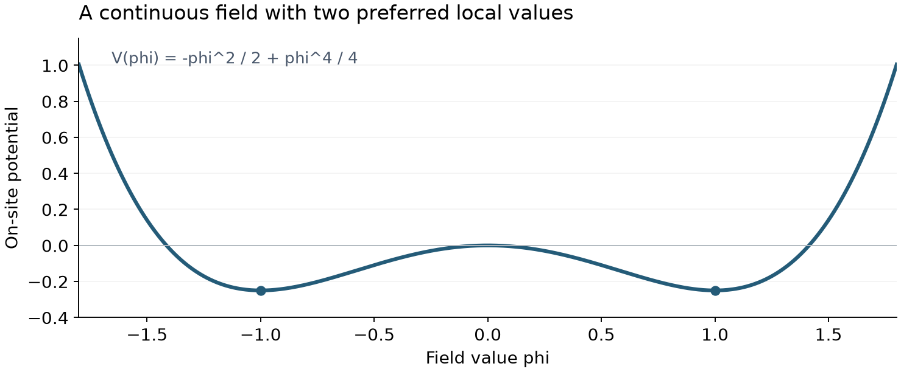

# Clean 3D phi4: Computational Physics Lab

This is my project for PHYSICS 5409 Computational Physics Lab at Missouri
University of Science & Technology. I study the phase transition of a clean
three-dimensional scalar phi4 model using Monte Carlo simulations.

The goals are to locate the transition, measure its finite-size behavior, and
compare the estimated critical exponents with the three-dimensional Ising
universality class. The simulation is written in C++17, with Python for running
calculations, analyzing the data, and making figures.

## Methods and workflow

- **Metropolis sampling:** real-valued fields on periodic cubic lattices,
  with random and ordered starts. Proposal sizes are adapted before production
  and then held fixed during settling and measurements.
- **Parallel tempering:** one MPI worker per temperature, with exchanges between
  neighboring temperatures to improve sampling. Local updates remain Metropolis.
- **Observables:** energy, magnetization, normalized Binder cumulant, and
  susceptibility. The plotted Binder cumulant approaches one in the ordered
  limit and zero in the Gaussian high-temperature limit.
- **Finite-size analysis:** Binder crossings and temperature slopes, magnetization
  and susceptibility scaling, and comparisons across lattice sizes.
- **Uncertainty checks:** autocorrelation, contiguous-block resampling,
  independent-start comparisons, and sensitivity to fit windows and block size.
- **Mill runs:** preserved configurations, seeds, source snapshots, raw histories,
  and checksums for each calculation.

## Model

Each lattice site holds a real-valued field rather than a binary spin. Neighboring
sites interact, while the local potential favors two field values:

```text
H = -J sum_<ij> phi_i phi_j + sum_i [(r/2) phi_i^2 + (u/4) phi_i^4]
```

The current study keeps `J=1`, `r=-1`, and `u=1` fixed. Lattice size, temperature,
seed, and sweep counts are configured in TOML.



*The curve shows the analytical on-site term only. It is a model illustration,
not a simulation result or an estimate of the transition temperature.*

## Running locally

Requires a C++17 compiler, CMake 3.21+, Ninja, and Python 3.11+. Install the Python
analysis dependencies in your Python environment, then build from the
repository root:

```sh
python -m pip install -r analysis/requirements.txt
cmake --preset local-debug
cmake --build --preset local-debug
ctest --test-dir build/local-debug --output-on-failure
```

The default build requires no MPI installation. MPI is used for the parallel
tempering runs on Mill; see the [parallel tempering notes](docs/PARALLEL_TEMPERING.md).
The tests check numerical formulas and the run/analysis workflow. Equilibration
and critical scaling require separate checks on the simulation data.

See [development setup](docs/DEVELOPMENT.md) for virtual environments, compiler
selection, macOS instructions, and a separate build for each platform.

### Small test run

Validate the input without running a simulation:

```sh
python scripts/run.py configs/local/smoke.example.toml --validate-only
```

To execute the tiny `L=4` check after building:

```sh
# Windows
python scripts/run.py configs/local/smoke.example.toml --binary build/local-debug/phi4.exe

# Linux or macOS
python scripts/run.py configs/local/smoke.example.toml --binary build/local-debug/phi4
```

This input performs 100 settling sweeps and saves 100 measurement rows. It writes
`measurements.csv`, `equilibration.csv`, a resolved configuration, a source
snapshot, and run metadata under `data/raw/local-smoke/`. Reusing the same output
path is refused; choose a new run ID for another attempt. This is an operational
example, not a production physics calculation.

## Project layout

| Component | Start here | Purpose |
| --- | --- | --- |
| Lattice and energy | [model.hpp](include/phi4/model.hpp) | Periodic neighbors, energy, and local energy changes |
| Local sampler | [sampler.hpp](include/phi4/sampler.hpp) | Initialization, proposals, acceptance, and measurements |
| Executables | [main.cpp](src/main.cpp), [pt.cpp](src/pt.cpp) | Chain execution and serial/MPI tempering |
| Run workflow | [run.py](scripts/run.py), [run_pt.py](scripts/run_pt.py) | Validate inputs and preserve outputs and provenance |
| Analysis | [phi4_analysis](analysis/phi4_analysis/) | Load data, calculate observables, estimate errors, and plot diagnostics |
| Checks | [C++ tests](tests/cpp/), [Python tests](tests/python/) | Independent numerical and workflow checks |

For a closer look, read the [code walkthrough](docs/CODE.md) and
[validation plan](docs/VALIDATION.md). [Architecture](docs/ARCHITECTURE.md)
explains the boundaries between the components. MPI setup and replica-exchange
checks are documented in [parallel tempering](docs/PARALLEL_TEMPERING.md).

## Scientific status

The simulation, analysis, and cluster workflows are implemented. Critical
exponents remain preliminary: passing software checks and completing runs do not
by themselves establish equilibrium or asymptotic scaling. Raw histories,
independent starts, block sizes, and fit sensitivity must still support any
scientific claim. The [validation plan](docs/VALIDATION.md) explains the
checks required before interpreting results.

Generated builds, raw datasets, working plots, and internal research planning
notes stay out of Git.

## Acknowledgment

Codex assisted with implementation and debugging. I remain responsible for
reviewing the code and validating the scientific results.
